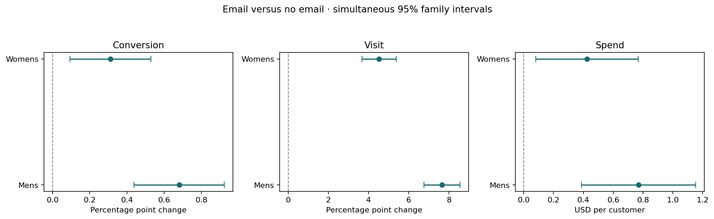

# Decision Science Lab

[](https://github.com/Swapnil-byte-798/decision-science-lab/actions/workflows/ci.yml)

Four real-data case studies for data science and decision analytics roles. Python performs
the statistical work; SQL computes business metrics. No Kaggle key, paid API, or frontend
development is required. These are historical analyses, not claims of live business impact.

| Project | Question | Important topics | Executed report |
|---|---|---|---|
| Campaign experiment | Did an email increase purchases? | A/B/N, confidence intervals, power, MDE, SRM, multiple testing | [Readout](reports/01_experiments/readout.md) |
| Causal targeting | Who should receive a limited campaign? | Uplift, T-learners, leakage, validation, IPW, Qini, paired comparison | [Readout](reports/02_uplift/readout.md) |
| Customer analytics | Which cohorts return and which customers buy repeatedly? | SQL CTEs/windows, cohort censoring, RFM, reconciliation | [Readout](reports/03_customer_analytics/readout.md) |
| Revenue forecasting | Can a model beat a simple baseline? | Lag features, chronological validation, rolling origins, MAE/WAPE | [Readout](reports/04_forecasting/readout.md) |

## Results

- **64,000 randomized experiment participants.** Mens email versus no email raises
  observed conversion by **0.6805 percentage points**, with simultaneous family interval
  **[0.4376, 0.9235] pp**. Six comparisons use Holm-adjusted p-values and Bonferroni intervals.
- **8,523 untouched uplift test customers.** A validation-selected forest T-learner targeting
  30% estimates **0.0251 incremental visits per eligible customer** (pointwise 95% bootstrap
  interval **[0.0148, 0.0350]**). Random targeting at the same expected budget estimates
  **0.0222**. The report includes the paired advantage interval; a positive policy value
  does not by itself prove superiority over random targeting.
- **541,909 real retail rows → 524,878 positive-sale lines.** Complete-month SQL analysis
  covers **19,141 orders and 4,297 identified customers**. Anonymous purchases contribute
  gross sales but do not enter customer cohorts.
- **52 complete retail weeks.** Train on 26, select on 12, test on 14. The trailing four-week
  average wins validation and achieves final-test **WAPE 16.61%**, compared with Ridge
  **18.35%** and last-week naive **20.32%**. All three final scores are disclosed.



## Run

Use Python 3.11 or 3.12, from the repository root:

```bash
python -m venv .venv
# Windows PowerShell:
.venv\Scripts\Activate.ps1
# macOS/Linux instead:
# source .venv/bin/activate
python -m pip install -e ".[dev]"
decision-lab download
decision-lab run
python -m pytest -q
python -m ruff check .
```

If the console script is not on PATH, use `python -m decision_lab.cli`. The sources total
about 24 MB. The first Excel parse can take a minute; subsequent runs use a local cache.
Missing data or checksum mismatch stops the run. There is no generated substitute dataset.

```bash
decision-lab download --project experiments
decision-lab run --project experiments
decision-lab run --project uplift
decision-lab run --project customers
decision-lab run --project forecasting
```

Outputs include Markdown decisions, JSON, charts and aggregate CSVs. SQL also creates a
local SQLite database. Import the aggregate CSVs into Power BI if desired; no Desktop
render or supplied PBIX is claimed. [Power BI guide](docs/power-bi.md).

## Existing-project integration

[StockSense](https://github.com/Swapnil-byte-798/stocksense-monte-carlo-lab) now includes
`python -m stocklab compare-policies`: paired weekly block-bootstrap intervals and a service
guardrail on the existing real UCI sales replay. The profit interval includes zero and service
worsens, so the illustrative promotion gate rejects the candidate. This is an offline replay.

Credit Risk Lab already has a validation-only champion/challenger gate. SourceDesk lacks
randomized real-user outcomes, and RxInsight's present synthetic data cannot establish real
campaign causality. We do not invent A/B results for those projects. [Integration decisions](docs/portfolio-fit.md).

## Data and learning

- **Hillstrom / MineThatData:** 64,000 prior purchasers, randomized to three arms; two-week
  outcomes. [Original challenge](https://blog.minethatdata.com/2008/03/minethatdata-e-mail-analytics-and-data.html).
  The downloader uses the checksum-pinned mirror documented by
  [scikit-uplift](https://github.com/maks-sh/scikit-uplift/blob/master/sklift/datasets/datasets.py).
  Raw data are excluded from Git; no dataset license is inferred from a documentation footer.
- **UCI Online Retail:** Chen, D. (2015), [DOI 10.24432/C5BW33](https://doi.org/10.24432/C5BW33),
  [official dataset](https://archive.ics.uci.edu/dataset/352/online+retail), CC BY 4.0.
  Derived retail aggregates retain attribution. [Data notice](DATA-NOTICE.md).
- [Study and interview guide](docs/study-guide.md): fundamentals, analogies and exercises.
- [Analysis contracts](docs/analysis-contracts.md): units, estimands, splits, checks and limits.
- [Requirements](docs/project-brief.md) and [validation](docs/validation.md).

Code is MIT licensed. Source-data rights are separate. Hand-calculated fixtures appear
only in tests; all analysis reports use downloaded real records. Customer-level outputs,
raw data, databases, caches and credentials are excluded from Git.
